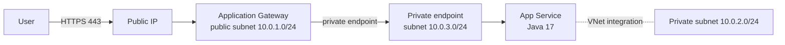

# ShopEasy: Java e-commerce demo on Azure (CI/CD + Terraform)

A small one-page Java store used to practise a complete DevOps delivery path on Azure:
build and test in two CI systems, deploy to App Service, and run it behind a private network with an Application Gateway and HTTPS.

The Java app is deliberately simple. The focus of this project is the pipelines and the infrastructure.

## Architecture



- The Application Gateway is the only public entry point (public subnet).
- The App Service is reached through a private endpoint. Its own `*.azurewebsites.net` address returns **403** from the internet.
- Private DNS (`privatelink.azurewebsites.net`) lets the gateway resolve the app's private address.
- No virtual machines are created or managed: App Service and Application Gateway are managed services.

## Tech stack

| Area | Tools |
|---|---|
| App | Java 17, Spring Boot 3, Maven, one static page |
| CI/CD | GitHub Actions, Azure DevOps Pipelines (YAML) |
| Infrastructure as code | Terraform (azurerm 4.x) |
| Azure | VNet, subnets, NSG, Application Gateway v2, Private Endpoint, Private DNS, App Service (Linux, B1) |
| HTTPS | Let's Encrypt certificate, uploaded to the Application Gateway |

## Repository layout

```
.
├── pom.xml                     # builds target/app.jar
├── src/                        # Spring Boot app, one-page UI, one test
├── infra/                      # Terraform (network, gateway, app service)
├── .github/workflows/ci-cd.yml # GitHub Actions: build, test, deploy
└── azure-pipelines.yml         # Azure DevOps: build, test, deploy
```

## CI/CD

Both pipelines follow the same flow:

1. Check out the code and install Java 17.
2. `mvn verify` compiles the app and runs the test.
3. Save `app.jar` as a pipeline artifact.
4. Deploy the jar to the App Service (only on `main`).

- **GitHub Actions** deploys with the App Service publish profile, stored as a repository secret.
- **Azure DevOps** deploys through an Azure Resource Manager service connection and a `production` environment.

## Deploy it yourself

1. Create the infrastructure:
   ```
   cd infra
   terraform init
   terraform apply -var="subscription_id=<your-subscription-id>"
   ```
   Note the `app_name` and `app_gateway_public_url` outputs.
2. Add the pipeline secrets:
   - GitHub: secret `AZURE_WEBAPP_PUBLISH_PROFILE` and variable `AZURE_WEBAPP_NAME`.
   - Azure DevOps: service connection `azure-service-connection` and the app name in `azure-pipelines.yml`.
3. Push to `main`, then open the gateway URL.

### Enabling HTTPS

HTTPS is optional in the Terraform code. Provide a `.pfx` certificate to turn it on:

```
terraform apply \
  -var="subscription_id=<your-subscription-id>" \
  -var="ssl_pfx_path=./shopeasy.pfx" \
  -var="ssl_pfx_password=<pfx-password>"
```

This opens port 443, adds the HTTPS listener and redirects HTTP to HTTPS. Never commit the `.pfx` or its password (`.gitignore` already excludes `*.pfx`).

How the certificate was produced for the demo: a free DuckDNS name pointed at the gateway IP, a Let's Encrypt certificate requested with certbot using the DNS-01 challenge, then converted to `.pfx` with OpenSSL. The demo was first configured with the Azure CLI, and this Terraform codifies the same settings.

## Security notes

- The app is not directly reachable from the internet; only the gateway is public.
- The deployment (SCM) endpoint is left open so hosted CI runners can deploy. In production I would use a self-hosted agent inside the VNet and lock this down.
- GitHub deploys with a publish profile for simplicity. OIDC login would be the better choice for production.
- Secrets live in GitHub Secrets and Azure DevOps service connections, never in the repo.

## Cost and clean-up

The Application Gateway is the main cost. Delete everything when you are done:

```
terraform destroy -var="subscription_id=<your-subscription-id>"
```

If the Terraform state is lost, delete the `rg-ecomm-demo` resource group in the Azure Portal instead.

## What I learned

- Terraform provider rules matter: the health check needs both a path and an eviction time.
- Cloud Shell sessions can be ephemeral, so the Terraform state was lost. Use a remote backend (Azure Storage) for real projects.
- A private endpoint plus access restrictions blocks the default app URL (403), which is the intended result.
- Application Gateway needs specific NSG rules (GatewayManager ports) to work.
- Let's Encrypt DNS validation needs a free DNS name and a working API token.

## Next steps

- Docker image and Azure Container Registry.
- Remote Terraform state in Azure Storage.
- WAF on the Application Gateway, and Key Vault for the certificate.
- Application Insights and alerts.
